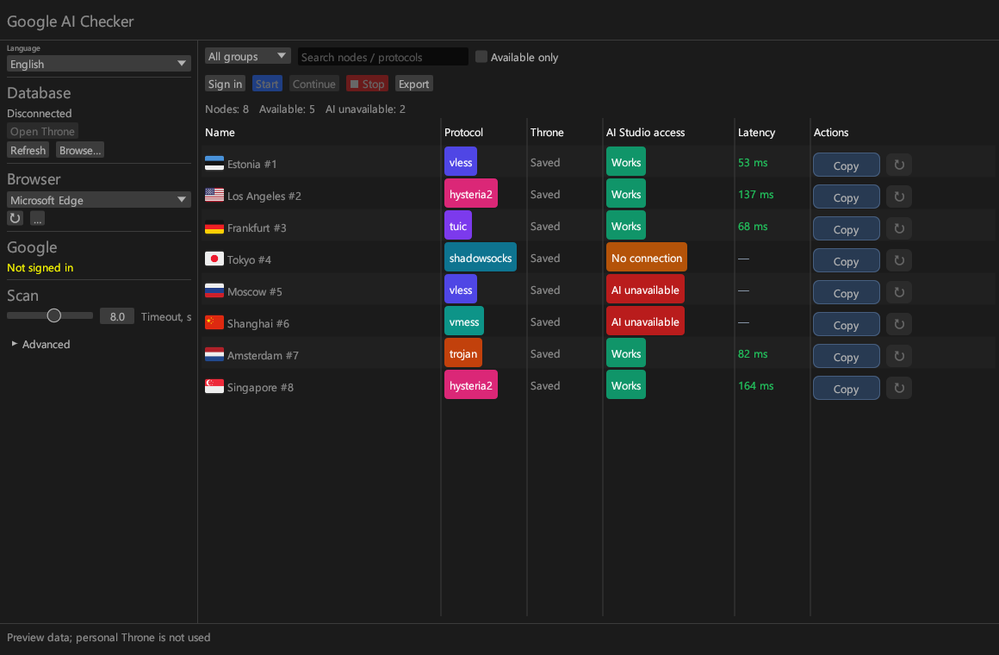

# Google AI Checker

[English](README.md) · [Русский](README.ru.md) · [简体中文](README.zh-CN.md) · [فارسی](README.fa.md)

Check which of your Throne profiles can access Google AI Studio.

Checks run up to 10 at a time: **52 profiles in about 8 seconds** in local tests. Timing depends on the proxies and network.



*Demo profiles, not live results.*

## Use

Download a ZIP from [Releases](../../releases) and extract the whole folder. Throne is included.

1. Open the checker and select your Throne database.
2. Choose a browser, click **Sign in**, then **Done** after signing in to Google.
3. Select a group and click **Start**. Use **↻** to recheck one profile or **Copy** to copy its configuration JSON.

The checker runs parallel requests to AI Studio through the official Throne core. A model-list response confirms access; latency includes the proxy connection and HTTPS request. Results and sign-in data stay in `sandbox_data/` beside the app. Refresh after editing profiles in Throne.

## Systems

| System | Build status |
| --- | --- |
| Windows x64 (DirectX 12) | ZIP built and checked |
| Linux x64 desktop | CI configured; build not yet verified |
| macOS Intel / Apple Silicon | CI configured; builds not yet verified |

Only the Windows ZIP has been built and checked so far. Linux and macOS still need a successful CI run.

## Build

Rust 1.98+ (edition 2024), a C/C++ toolchain (MSVC on Windows), Git, CMake, Perl, libclang and curl are required.

```sh
cargo xtask dist
```

The ZIP and checksum appear in `target/dist/`. To change Throne, edit the single version in [`throne-version.txt`](throne-version.txt). `xtask` finds the matching archive, gets its SHA-256 from GitHub and handles the download and packaging.

The GitHub Actions workflow is configured to build four bundles and upload them to GitHub Releases on a `v*` tag. Translations live in `locales/`; use the English strings in `en.json` as keys in every language.

## Credits

[Throne](https://github.com/throneproj/Throne) provides the proxy core and profile management. Its [API](https://github.com/throneproj/Throne-api) makes this checker possible. Fonts: [Noto](https://fonts.google.com/noto). Flags: [Twemoji](https://github.com/jdecked/twemoji). Third-party notices are in `FONT-LICENSES.txt`.
